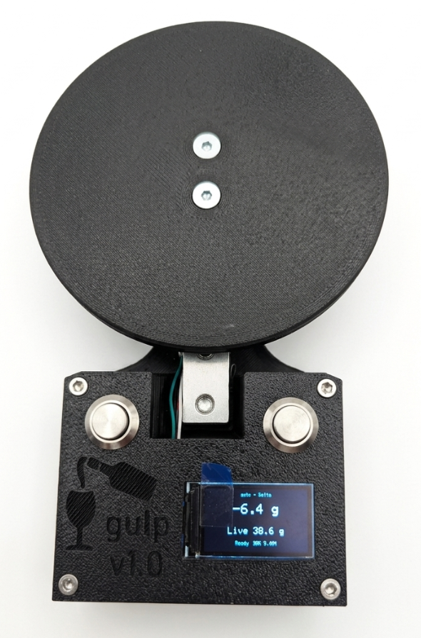

# gulp

`gulp` is a device designed to tell you how much of your beverage you've consumed, and how quickly. Regardless of if you're drinking water or poitín - you can now track _exactly_ how much you've had.

For usage, see [Normal Use](#normal-use).

Disclaimer: most of the code for this project was AI generated.



## Build

A picture tells a thousand words. Unfortunately, the assembly was extremely rushed so there are none in these instructions.

### Required Hardware

The provided links are examples that should probably work.

#### Electronics

- ESP32 TTGO T-Display (ST7789 135x240 TFT) \[[link](https://aliexpress.com/item/33050639690.html)\]
- HX711 load cell amplifier & load cell \[[link](https://aliexpress.com/item/1005001537354199.html)\]
- LiPo battery with JST 1.25 connector \[[link](https://www.amazon.de/-/en/gp/product/B0F18ST3K5)\]
- Two momentary push buttons w/ 16mm body width \[[link](https://aliexpress.com/item/1005003400929705.html)\]
- Male USB-C breakout board \[[link](https://aliexpress.com/item/1005009847773743.html)\]
- Female Vertical USB-C breakout board \[[link](https://aliexpress.com/item/1005009011843269.html)\]
- 0.25mm<sup>2</sup> wire (24 AWG)

#### Misc Components

- Fasteners:
  - 2 M4 * 20mm DIN7991 bolts
  - 2 M5 * 25mm DIN912 bolts
  - 6 M3 * 10mm DIN912 bolts
- Inserts:
  - 6 Heatset M3 inserts \[[link](https://cnckitchen.store/products/heat-set-insert-m3-x-5-7-100-pieces)\]
- 3D printing:
    - ~120 grams of filament (I used PLA)
    - Access to a 3D printer (I used a Prusa MK4)

#### Tools

- Soldering iron & solder
- Hex key set
- Isopropanol
- Kapton tape (or similar)
- Hot glue (optional but recommended)

### Assembly

#### Setup

**Printed Parts**
1. Print parts in [cad/stl](cad/stl). I recommend printing at least the mounting locations with 5 perimeters.
2. Insert the heatset inserts.

**Devboard Prep**
1. Use some isopropanol to loosen the adhesive connecting the screen to the ESP32 and gently move it up.
2. The adhesive will become sticky again once the isopropanol evaporates so cover the board with a bit of kapton tape to prevent sticking.

**Wiring**
1. Solder the Load Cell to the HX711 and the HX711 to the ESP32 according to the [wiring table](#wiring) below.
2. Connect the buttons to the ESP32 according to the [wiring table](#wiring). You will need to disconnect them later.

**USB-C Extension**
1. Connect the male and female usb breakout boards as shown to create the extension cable.

#### Test

This step is optional but _highly_ recommended.

1. Follow the instructions for [Firmware](#firmware) up to and including [Calibration](#calibration) 3, then continue. We want to ensure all of the components work but not to calibrate the scale at this stage.
2. Disconnect the buttons from the ESP32.

#### Build

1. Insert the buttons into the top cover and fasten them with the included nuts.
2. Fasten the load cell to the base with the M5 bolts.
3. Fasten the female end of the usb extension to the base using M3 bolts.
4. Solder the buttons to the ESP32 according to the wiring table.
5. Plug the battery in to the ESP32.
6. Plug the male end of the usb extension into the ESP32.
7. Test the setup again.
8. Slide the display of the devboard up and through the hole on the LEFT side of the top cover. Fasten it down with _a small amount_ hot glue or thin adhesive tape.
9. Insert the rest of the components into the base, securing with a dab of hot glue or tape where required.
10. Place the cover on the base.
11. Secure the cover with the M3 bolts.
12. Fasten the scale to the load cell using the M4 bolts.
13. Follow the instructions for [Build and Flash](#build-and-flash) and [Calibration](#calibration) below.

#### Wiring

| Signal | MCU Pin |
|--------|------|
| Load Cell Red | HX711 E+ |
| Load Cell Black | HX711 E- |
| Load Cell White | HX711 A- |
| Load Cell Green | HX711 A+ |
| HX711 data | GPIO 26 |
| HX711 clock | GPIO 27 |
| HX711 PWR | 5v |
| HX711 GND | GND |
| Button 1 | GPIO 32 & GND |
| Button 2 | GPIO 33 & GND |

### Firmware

#### Setup

With Nix (recommended):

```sh
direnv allow
```

or:

```sh
nix develop
```

This dev shell provides `platformio`, `python3`, and `esptool`.

Without Nix, install [PlatformIO Core](https://docs.platformio.org/en/latest/core/installation/index.html).

### Build And Flash

Build:
```sh
pio run
```

Build and flash:
```sh
pio run -t upload
```

Open device serial:
```sh
pio device monitor
```

### Calibration

Calibration is controlled by [`include/AppConfig.h`](include/AppConfig.h).

1. Set `kCalibrationMode = true`.
2. Build and flash the firmware.
3. Follow the on-screen flow:
   - HX711 diagnostic
   - button test
   - tare with no weight on the scale
   - weigh a known reference mass (`kReferenceMassG`, default `190 g`)
4. Copy the reported `kScaleFactor` into [`include/AppConfig.h`](include/AppConfig.h).
5. Set `kCalibrationMode = false`.
6. Build and flash again.

The calibration screen shows both the raw offset and the computed scale factor. The serial output prints the scale factor snippet to copy back into config.

Normal boots auto-tare the scale again to account for drift. It is also possible to manually tare the scale through the UI.

## Usage

### Normal Use

1. Put your bottle, glass, or container on the scale.
2. Wait for the device to settle and capture the baseline.
3. Lift it off, drink or pour, then place it back.
4. Read the displayed delta.

Bottle and Glass modes show the same measured delta, but use different label sets tuned for larger pours vs smaller sips.

### Runtime Behavior

The main state machine lives in [`src/ScaleEngine.cpp`](src/ScaleEngine.cpp).

1. Baseline capture: a stable reading above `5.0 g` for `800 ms` becomes the baseline.
2. Removed state: a reading below `2.0 g` for `500 ms` counts as removed.
3. Replacement: once the item is back and stable, the firmware latches the signed delta and updates the baseline.
4. Filtering: live readings are smoothed with a trimmed-mean window of 12 samples.
5. Rate tracking: the Bottle and Glass views show cumulative grams lost and grams/hour. Only negative deltas count toward consumption.
6. Idle behavior: after `10 minutes` without a button event, state transition, or a weight change of at least `3.0 g`, the display and HX711 are suspended and the board drops into light sleep.
7. Deep sleep: after `60 minutes` of continuous idle time, the device enters deep sleep.

When waking from idle, the firmware can reconcile a missed remove/replace cycle if the scale wakes up to a new stable weight that differs enough from the last baseline.

### Modes

Mode switching is handled in [`src/main.cpp`](src/main.cpp).

| Mode | Description |
|------|-------------|
| Bottle | Shows the absolute latched delta, a randomized bottle-themed label, grams/hour, total grams lost, current live weight, and elapsed session time. Positive deltas show refill labels. |
| Glass | Same measurement and grid as Bottle mode, but uses label thresholds tuned for smaller deltas. |
| Target | Shows the stored target weight and the live difference from that target. Long-press Button 1 to capture a new target. |
| Live | Shows the real-time weight. Values with magnitude below `0.1 g` display as `0.0 g`. |

### Buttons

The firmware refers to the buttons as Button 1 and Button 2 internally. The on-screen help overlay labels them `BTN_R` and `BTN_L`.

| Button | Short press | Long press |
|--------|-------------|------------|
| Button 1 (GPIO 32) | Cycle modes (`Bottle -> Glass -> Target -> Live`) | Set target in Target mode; otherwise tare the HX711 and reset the current session |
| Button 2 (GPIO 33) | Wake from idle, or cycle brightness (`100% -> 50% -> 19%`) | Enter deep sleep |
| Both | Show the help overlay while both are held | In calibration button test, holding both long advances to the next step |
